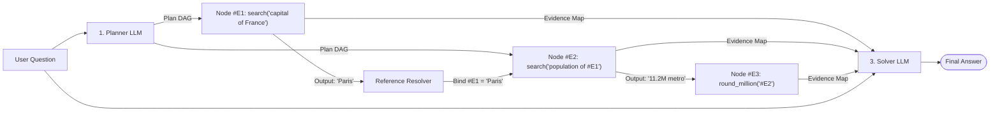

# 02. ReWOO and Plan-and-Execute: Decoupled Planning

> **Nguồn bài học:** [AI Engineering From Scratch — Phase 14: Agent Engineering / 02. ReWOO and Plan-and-Execute](https://aiengineeringfromscratch.com/lesson?path=phases%2F14-agent-engineering%2F02-rewoo-plan-and-execute)

---

## 1. Core Insights (Đúc kết cốt lõi)

1. **Chi phí bậc hai ($\mathcal{O}(N^2)$) và sự mong manh của vòng lặp ReAct:**
   Trong ReAct, mỗi bước gọi công cụ (tool call) phải mang theo toàn bộ lịch sử ngữ cảnh trước đó (`Thought 1 + Action 1 + Observation 1 + ... + Thought k`). Chiều dài prompt tại bước thứ $k$ tăng tuyến tính theo $k$, dẫn đến tổng số token tiêu thụ sau $N$ bước tăng theo hàm bậc hai $\mathcal{O}(N^2)$. Tệ hơn, khi một tool trả về lỗi ở giữa vòng lặp, mô hình phải vừa xử lý lỗi vừa suy luận lại toàn bộ kế hoạch ngay trong dòng chảy ngữ cảnh đang bị nhiễu.
2. **Triết lý ReWOO (*Reasoning Without Observations* — Xu et al., 2023):**
   Tách biệt hoàn toàn **Lập kế hoạch (Planning)** khỏi **Thực thi & Quan sát (Execution & Observation)**. Thay vì vừa đi vừa nghĩ từng bước, ReWOO thực hiện:
   - **1 lần gọi LLM (Planner):** Lập toàn bộ đồ thị kế hoạch (Plan DAG) ngay từ đầu với các biến giữ chỗ bằng chứng (`#E1`, `#E2`, ...).
   - **$N$ lần gọi Tool (Workers):** Thu thập bằng chứng theo thứ tự phụ thuộc (hoặc chạy song song các nhánh độc lập) mà không cần đính kèm chuỗi suy luận.
   - **1 lần gọi LLM (Solver):** Tổng hợp câu trả lời cuối cùng từ câu hỏi gốc, kế hoạch và toàn bộ bằng chứng.
3. **Tiết kiệm ~5x Token, tăng độ chính xác và mở khóa Planner Distillation:**
   Trên bộ benchmark HotpotQA, ReWOO sử dụng **ít hơn ~5 lần token** nhưng đạt **+4% độ chính xác tuyệt đối** so với ReAct. Quan trọng hơn, vì `Planner` không bao giờ nhìn thấy `Observation` thực tế lúc lập kế hoạch, ta có thể **chưng cất (distill) kỹ năng lập kế hoạch từ mô hình 175B xuống mô hình nhỏ 7B**. Đây là nền tảng cho kiến trúc chuẩn năm 2026: dùng mô hình nhỏ chuyên biệt làm Planner kết hợp với mô hình lớn làm Solver/Executor (hoặc ngược lại).
4. **Trục tiến hóa của Decoupled Planning (ReWOO → Plan-and-Execute → Plan-and-Act):**
   - **ReWOO (05/2023):** Kế hoạch tĩnh dạng DAG; đánh đổi sự linh hoạt để lấy hiệu suất token tối đa và khả năng cô lập lỗi theo từng node.
   - **Plan-and-Execute (08/2023 — LangChain):** Tổng quát hóa ReWOO bằng cách thêm một node **Replanner** tùy chọn sau khi thực thi một phần kế hoạch, đưa kết quả quan sát quay lại cập nhật kế hoạch khi cần thiết.
   - **Plan-and-Act (ICML 2025 — Erdogan et al.):** Mở rộng lên các tác vụ dài hạn (**long-horizon > 30–50 bước** như điều hướng WebArena/Mobile) thông qua bộ sinh dữ liệu quỹ đạo kế hoạch tổng hợp (**synthetic plan data**), giúp mô hình giữ được tính mạch lạc ở độ sâu mà một chuỗi ReAct đơn lẻ bị mất phương hướng.

---

## 2. Cơ chế ReWOO: Kiến trúc Ba Vai Trò (Planner – Workers – Solver)

Được đề xuất bởi Xu et al. ([arXiv:2305.18323](https://arxiv.org/abs/2305.18323), 05/2023), ReWOO chia tách luồng xử lý của Agent thành 3 vai trò độc lập:

```text
Planner:  user_question               --> [plan_dag]
Workers:  [plan_dag]                  --> [evidence]     (gọi tool theo DAG, có thể song song)
Solver:   user_question, plan_dag, evidence --> final_answer
```



### Phân tích chi tiết 3 thành phần

| Vai trò | Đầu vào (Input) | Đầu ra (Output) | Đặc điểm kỹ thuật cốt lõi |
| :--- | :--- | :--- | :--- |
| **1. Planner** | `user_question` + `tool_catalog` | Đồ thị kế hoạch không chu trình (**Plan DAG**) | Sinh danh sách các bước `(id, tool, args)`. Sử dụng ký hiệu tham chiếu bằng chứng như `#E1`, `#E2` để biểu diễn sự phụ thuộc dữ liệu giữa các bước mà chưa cần biết giá trị thực tế. |
| **2. Workers** | `plan_dag` | Từ điển bằng chứng `evidence` (`{"E1": "...", "E2": "..."}`) | Thực thi các node theo thứ tự tô-pô (`topological order`). Tại thời điểm điều phối (dispatch time), bộ thực thi thay thế `#E<k>` bằng kết quả của worker trước đó. Các node cùng tầng không phụ thuộc nhau có thể chạy **song song**. |
| **3. Solver** | `user_question` + `plan_dag` + `evidence` | `final_answer` | Ghép nối toàn bộ bằng chứng thu thập được với kế hoạch ban đầu để sinh câu trả lời hoàn chỉnh trong một lần gọi LLM duy nhất. |

### Tại sao ReWOO vượt trội ReAct trên các tác vụ có cấu trúc?

1. **Hiệu quả Token (~5x Fewer Tokens):**
   - Trong **ReAct**, ở bước thứ 10, prompt gửi lên LLM phải chứa lại toàn bộ: `Prompt gốc + (Thought 1 + Action 1 + Obs 1) + ... + (Thought 9 + Action 9 + Obs 9)`. Câu hỏi gốc và mọi suy luận trung gian bị lặp lại ở từng bước.
   - Trong **ReWOO**, hệ thống chỉ tốn **1 prompt cho Planner**, **$N$ lệnh gọi tool nhỏ gọn** (chỉ truyền tham số hàm, không gánh lịch sử hội thoại), và **1 prompt cho Solver**.
2. **Cô lập lỗi theo từng Node (Per-Node Failure Localization):**
   - Trong **ReAct**, nếu bước 3 gọi tool bị lỗi, vòng lặp phải tự suy luận để thoát khỏi lỗi ngay giữa dòng chảy đang thực thi — rất dễ dẫn đến hiệu ứng dây chuyền hoặc quên mất mục tiêu ban đầu.
   - Trong **ReWOO**, nếu Worker 3 gặp lỗi, nó chỉ đơn giản ghi nhận một chuỗi lỗi vào `evidence["E3"]`. Khi `Solver` chạy, nó nhìn thấy lỗi của `#E3` đặt trong bức tranh tổng thể của kế hoạch ban đầu và các bằng chứng `#E1`, `#E2` đã thành công, từ đó có thể **suy giảm êm dịu (degrade gracefully)** thay vì làm sập toàn bộ tiến trình.
3. **Chưng cất Planner (Planner Distillation — 175B → 7B):**
   - Vì Planner chỉ làm nhiệm vụ dịch `user_question` sang cấu trúc `Plan DAG` mà không bị phụ thuộc vào dữ liệu trả về muôn hình vạn trạng từ môi trường (`Observation`), bài toán lập kế hoạch trở nên gọn và đồng nhất hơn rất nhiều.
   - Nhóm tác giả chứng minh có thể thu thập các trace kế hoạch từ mô hình Teacher 175B để fine-tune cho mô hình Student 7B. Khi chạy thực tế (inference), mô hình 7B đảm nhiệm việc lập kế hoạch với chất lượng tương đương mà không cần gọi mô hình khổng lồ ở bước đầu.

---

## 3. Sự tiến hóa: Plan-and-Execute (2023) & Plan-and-Act (2025)

### Plan-and-Execute (LangChain, 08/2023)

Nhược điểm lớn nhất của ReWOO thuần túy là **kế hoạch tĩnh (static plan)**: nếu kết quả của `#E1` làm thay đổi hoàn toàn hướng đi tiếp theo, DAG ban đầu sẽ không còn phù hợp.

Mẫu **Plan-and-Execute** giải quyết điểm này bằng cách:
1. **Planner** lập danh sách các bước ban đầu.
2. **Executor** thực thi từng bước (hoặc từng nhóm bước).
3. **Replanner (Tùy chọn):** Quan sát kết quả thực thi vừa rồi để quyết định giữ nguyên phần còn lại của kế hoạch, chỉnh sửa các bước tiếp theo, hoặc kết thúc sớm.

> **Bản chất:** Plan-and-Execute đưa `Observation` quay trở lại khâu lập kế hoạch thông qua Replanner (gần với ReAct hơn so với ReWOO thuần túy), nhưng vẫn giữ được lợi thế tiết kiệm token nhờ không phải suy luận lại từ đầu ở mọi thao tác nhỏ.

### Plan-and-Act (Erdogan et al., ICML 2025 — [arXiv:2503.09572](https://arxiv.org/abs/2503.09572))

Khi áp dụng vào các tác vụ điều hướng web hoặc di động dài hạn (**long-horizon tasks**, kéo dài 30–50+ bước trên các môi trường như WebArena), một quỹ đạo ReAct đơn lẻ thường bị mất tính mạch lạc (lose coherence), trong khi dữ liệu huấn luyện cho Planner chất lượng cao lại rất khan hiếm.

Đóng góp cốt lõi của **Plan-and-Act**:
- Tách bạch rõ ràng hai mô hình **Planner** (lập kế hoạch cấp cao) và **Executor** (ánh xạ từng bước kế hoạch thành thao tác cụ thể trên giao diện).
- Xây dựng **Synthetic Plan Data Generator** (bộ sinh dữ liệu kế hoạch tổng hợp): tự động trích xuất và gán nhãn các kế hoạch tường minh từ các quỹ đạo hành động có sẵn, dùng để fine-tune các mô hình Planner có khả năng duy trì định hướng bền bỉ qua 30–50 bước.

### Bảng quyết định: Khi nào chọn mẫu kiến trúc nào?

| Mẫu thiết kế (Pattern) | Khi nào nên sử dụng (When to pick) | Đặc trưng cốt lõi |
| :--- | :--- | :--- |
| **ReAct** | Tác vụ ngắn (< 3 bước), môi trường chưa biết trước, cần phản ứng tức thời với ngoại lệ | Đan xen `Thought → Action → Observation` trong 1 luồng duy nhất. |
| **ReWOO** | Tác vụ có cấu trúc rõ ràng, bộ công cụ xác định, nhạy cảm về chi phí token, có thể lấy bằng chứng song song | Kế hoạch tĩnh dạng DAG (`Planner → Workers → Solver`), không có observation trong lúc lập kế hoạch. |
| **Plan-and-Execute** | Tương tự ReWOO nhưng kết quả trung gian có thể làm thay đổi các bước phía sau | Có thêm nút **Replanner** đánh giá lại kế hoạch sau khi thực thi từng phần. |
| **Plan-and-Act** | Tác vụ đường dài (**> 30 bước**), điều khiển trình duyệt web / mobile / computer-use | Tách Planner/Executor kết hợp huấn luyện bằng **dữ liệu kế hoạch tổng hợp (synthetic plans)**. |
| **Tree of Thoughts / LATS** | Bài toán đòi hỏi tìm kiếm, thử-sai và quay lui (backtracking) đáng để đánh đổi chi phí | Duyệt cây trạng thái (sẽ học ở Bài 04). |

> **Nguyên tắc thực chiến từ Anthropic (*Building Effective Agents*, 12/2024):** Luôn bắt đầu từ giải pháp đơn giản nhất. Nếu tác vụ chỉ gồm 1 lệnh gọi tool kèm bước tóm tắt, **đừng dựng ReWOO**. Ngược lại, nếu tác vụ là một bài toán nghiên cứu sâu kéo dài 40 bước, **đừng chỉ dùng ReAct đơn lẻ**.

### Ứng dụng trong các Framework hiện đại
- **LangGraph:** Cung cấp sẵn công thức kiến trúc Plan-and-Execute bằng đồ thị trạng thái (tách biệt với `create_react_agent` dùng cho ReAct).
- **CrewAI Flows:** Mã hóa trực tiếp mẫu thiết kế này — kỹ sư định nghĩa các bước công việc từ đầu và bộ điều phối Flow DAG thực thi chúng theo đúng phụ thuộc.

---

## 4. Tiêu chuẩn Kiểm định Kế hoạch (Plan DAG Validation & Guardrails)

Trong hệ thống Production (đúc kết từ `skill-rewoo-planner.md`), một Plan DAG do LLM sinh ra **không bao giờ được chuyển thẳng cho Worker** nếu chưa vượt qua 4 bước kiểm định tĩnh (Static Validation):

1. **Kiểm tra tính không chu trình (Acyclicity Check):**
   Chạy thuật toán sắp xếp tô-pô (`topological sort`). Nếu phát hiện chu trình (cycle) → **Từ chối cứng (Hard reject)**. ReWOO bắt buộc là một DAG; các vòng lặp thuộc về phạm vi của ReAct hoặc LATS.
2. **Kiểm tra phân giải tham chiếu (Reference Resolution Check):**
   Mọi biến giữ chỗ `#E<k>` nằm trong tham số của một bước phải trỏ tới một node `Ek` đã được định nghĩa và đứng **trước nó** trong thứ tự tô-pô. Nếu tham chiếu tới node chưa tồn tại hoặc đứng sau, hệ thống phải chỉ rõ cạnh phụ thuộc bị lỗi.
3. **Kiểm tra sự tồn tại của Tool (Tool Existence Check):**
   Mọi tên tool trong kế hoạch phải nằm trong `tool_catalog`. Tuyệt đối không cho phép Planner tự bịa (hallucinate) tên công cụ không tồn tại để ép kế hoạch có vẻ hợp lý.
4. **Kiểm tra Schema & Kiểu dữ liệu (Arg Schema Check):**
   Từng tham số truyền vào phải khớp với schema đầu vào của tool (bao gồm cả kiểu dữ liệu sau khi thay thế chuỗi `#E<k>`).
5. **Quy tắc từ chối an toàn (Refusal Rules):**
   - Nếu bài toán mang tính khám phá mở (chưa biết trước cần dùng những tool nào hay gồm bao nhiêu bước) → Từ chối lập kế hoạch tĩnh và chuyển hướng sang **ReAct** hoặc **LATS**.
   - Nếu `tool_catalog` chứa các công cụ có tính phá hủy (destructive tools) nhưng không có công cụ cổng phê duyệt (approval gate) → Từ chối thực thi và yêu cầu bổ sung cơ chế phân quyền/sandbox (Bài 09).

---

## 5. Kiến trúc tham chiếu (Minimal Python Reference)

Đoạn mã dưới đây (trích từ `code/main.py`, chỉ sử dụng Python `stdlib`) minh họa trọn vẹn cách cài đặt ReWOO gồm: phân giải tham chiếu `#E<k>`, sắp xếp tô-pô cho DAG, thực thi Workers, tổng hợp bằng Solver và đo lường đối chiếu chi phí ký tự với ReAct:

```python
from __future__ import annotations

import re
from dataclasses import dataclass, field
from typing import Any, Callable

@dataclass
class PlanStep:
    id: str
    tool: str
    args: dict[str, Any]

@dataclass
class Plan:
    steps: list[PlanStep]

class ToolRegistry:
    def __init__(self) -> None:
        self._tools: dict[str, Callable[..., str]] = {}

    def register(self, name: str, fn: Callable[..., str]) -> None:
        self._tools[name] = fn

    def dispatch(self, name: str, args: dict[str, Any]) -> str:
        fn = self._tools.get(name)
        if fn is None:
            return f"error: unknown tool {name!r}"
        try:
            return fn(**args)
        except Exception as e:
            return f"error: {type(e).__name__}: {e}"

REFERENCE_RE = re.compile(r"#E(\d+)")

def resolve_references(value: Any, evidence: dict[str, str]) -> Any:
    """Thay thế các placeholder #E1, #E2 bằng kết quả thực tế từ các Worker trước đó."""
    if not isinstance(value, str):
        return value
    return REFERENCE_RE.sub(
        lambda m: evidence.get(f"E{m.group(1)}", m.group(0)),
        value,
    )

def topological(plan: Plan) -> list[PlanStep]:
    """Sắp xếp các bước trong Plan DAG theo thứ tự phụ thuộc; báo lỗi nếu có chu trình."""
    resolved: list[PlanStep] = []
    known: set[str] = set()
    pending = list(plan.steps)
    while pending:
        progress = False
        rest: list[PlanStep] = []
        for step in pending:
            refs = REFERENCE_RE.findall(str(step.args))
            if all(f"E{r}" in known for r in refs):
                resolved.append(step)
                known.add(step.id)
                progress = True
            else:
                rest.append(step)
        if not progress:
            raise RuntimeError("cyclic plan or unresolved reference")
        pending = rest
    return resolved

def run_workers(plan: Plan, tools: ToolRegistry) -> dict[str, str]:
    """Thực thi từng bước theo thứ tự tô-pô và thu thập bằng chứng (evidence)."""
    evidence: dict[str, str] = {}
    for step in topological(plan):
        bound_args = {k: resolve_references(v, evidence) for k, v in step.args.items()}
        evidence[step.id] = tools.dispatch(step.tool, bound_args)
    return evidence

@dataclass
class ReWOORun:
    question: str
    plan: Plan
    evidence: dict[str, str] = field(default_factory=dict)
    answer: str = ""
    planner_chars: int = 0
    worker_chars: int = 0
    solver_chars: int = 0

def run_rewoo(question: str, planner: Any, tools: ToolRegistry, solver: Any) -> ReWOORun:
    # 1. Planner: 1 lần gọi để sinh toàn bộ Plan DAG
    plan = planner.plan_for(question)
    planner_chars = len(question) + sum(len(s.tool) + len(str(s.args)) for s in plan.steps)

    # 2. Workers: Thực thi các node theo DAG (không gánh lịch sử suy luận)
    evidence = run_workers(plan, tools)
    worker_chars = sum(len(str(s.args)) + len(v) for s, v in zip(plan.steps, evidence.values()))

    # 3. Solver: 1 lần gọi để tổng hợp câu trả lời cuối cùng
    answer = solver.solve(question, plan, evidence)
    solver_chars = len(question) + worker_chars + len(answer)

    return ReWOORun(
        question=question, plan=plan, evidence=evidence, answer=answer,
        planner_chars=planner_chars, worker_chars=worker_chars, solver_chars=solver_chars,
    )
```

**Ví dụ luồng chạy thực tế cho câu hỏi:** *"What is the population of the capital of France, rounded?"*
- **Plan DAG:**
  - `E1`: `search(query="capital of France")`
  - `E2`: `search(query="population of #E1")`
  - `E3`: `round_million(text="#E2")`
- **Evidence thu thập được:** `E1 -> "Paris"`, `E2 -> "11.2 million metro"`, `E3 -> "11 million"`.
- **Final Answer (Solver):** `"The capital of France is Paris; rounded population is 11 million."`

---

## 6. Bảng thuật ngữ cốt lõi (Key Terms)

| Thuật ngữ | Cách gọi thông thường | Bản chất kỹ thuật thực sự |
| :--- | :--- | :--- |
| **ReWOO** | "Reasoning without observations" | Lập kế hoạch toàn cục trước, thu thập bằng chứng (có thể song song), sau đó giải quyết ở bước cuối — không có `Observation` nào xuất hiện trong prompt lập kế hoạch. |
| **Plan-and-Execute** | "Mẫu plan-execute của LangChain" | Biến thể tổng quát hóa của ReWOO có kèm thêm một node **Replanner** tùy chọn sau khi thực thi. |
| **Plan-and-Act** | "Scaled plan-execute" | Tách biệt tường minh Planner/Executor kết hợp huấn luyện bằng **dữ liệu kế hoạch tổng hợp (synthetic plan data)** cho các tác vụ dài hạn (> 30 bước). |
| **Evidence reference** | "`#E1`, `#E2`, ..." | Biến giữ chỗ (placeholder) trong node kế hoạch, được bộ điều phối thay thế bằng đầu ra thực tế của worker đứng trước tại thời điểm chạy. |
| **Planner distillation** | "Small planner, big executor" | Kỹ thuật fine-tune một mô hình nhỏ (~7B) trên các vết kế hoạch (planner traces) sinh bởi mô hình Teacher lớn (~175B). |
| **Token efficiency** | "Ít vòng lặp gọi model hơn" | Giảm ~5 lần lượng token tiêu thụ trên HotpotQA so với ReAct nhờ loại bỏ việc lặp lại chuỗi suy luận qua từng bước. |
| **DAG executor** | "Topological dispatcher" | Bộ điều phối chạy các node kế hoạch theo thứ tự phụ thuộc tô-pô và thực thi song song các node độc lập ở cùng một tầng. |

---

## 7. Câu hỏi tự luyện & Mở rộng (Exercises & Quiz Takeaways)

1. **Thực thi song song các nhánh độc lập trong DAG (Parallel Worker Execution):**
   - Thay vì trả về danh sách phẳng `list[PlanStep]`, hàm `topological()` có thể gom nhóm các node có cùng bậc phụ thuộc vào từng tầng `list[list[PlanStep]]` (topological levels/generations).
   - Trên một DAG gồm 6 node chia làm 2 nhóm song song (mỗi nhóm 3 node chạy đồng thời), độ trễ (wall-clock latency) của bước thu thập bằng chứng giảm từ tổng thời gian của 6 lần gọi tool tuần tự xuống chỉ còn thời gian của **2 tầng chậm nhất**, trong khi tổng số token không đổi.
2. **Thay đổi nhỏ nhất để biến ReWOO thành Plan-and-Execute:**
   - Giữ nguyên `Planner` và `Workers`, nhưng kiểm tra từ điển `evidence` sau khi thực thi từng bước (hoặc từng tầng): nếu bất kỳ worker nào trả về chuỗi bắt đầu bằng `"error:"`, kích hoạt một node `Replanner(question, completed_evidence, failed_step)` để phát sinh phần DAG thay thế cho các bước còn lại trước khi đưa vào `Solver`.
3. **Kiến trúc Hybrid (`7B Planner` + `Frontier Solver`) và điểm gãy (Failure Modes):**
   - **Ưu điểm:** Giảm mạnh độ trễ và chi phí của bước lập kế hoạch ban đầu; mô hình lớn ở tầng `Solver` vẫn đảm bảo chất lượng tổng hợp ngôn ngữ và suy luận trên bằng chứng thu được.
   - **Điểm gãy:** Nếu câu hỏi đầu vào đòi hỏi suy luận ẩn dụ phức tạp để chọn đúng tool hoặc phân rã phụ thuộc nhiều tầng chưa từng xuất hiện trong tập dữ liệu chưng cất, mô hình 7B có thể sinh ra DAG thiếu bước hoặc nối sai tham chiếu `#E<k>`. Khi một nhánh bằng chứng bị thiếu từ gốc, dù `Solver` mạnh đến đâu cũng không thể tự gọi thêm tool để bù đắp (trừ khi có cơ chế fallback sang Replanner).
4. **Chưng cất Planner (175B → 7B) cần dữ liệu và thước đo gì?**
   - **Dữ liệu huấn luyện:** Các cặp `(user_question + tool_catalog, valid_plan_dag)` từ mô hình Teacher 175B, được lọc giữ lại những quỹ đạo mà sau khi thực thi và qua Solver cho ra đáp án đúng chuẩn (execution-verified trajectories).
   - **Thước đo chất lượng kế hoạch (Plan Scoring):** Tỉ lệ DAG hợp lệ về mặt cú pháp/không chu trình (syntactic validity), độ chính xác của chuỗi gọi tool và tham chiếu (graph edit distance / tool recall), và độ chính xác của câu trả lời cuối cùng khi giữ cố định cùng một Solver (downstream Exact Match / F1).
5. **Đánh đổi khi chuyển từ DAG (ReWOO) sang Chuỗi tuần tự (Plan-and-Act Sequence):**
   - Biểu diễn kế hoạch dưới dạng danh sách tuần tự (sequence) giúp việc sinh dữ liệu tổng hợp và huấn luyện tự hồi quy (autoregressive fine-tuning) trên các tác vụ điều hướng UI/Web dài hạn trở nên đơn giản, tự nhiên hơn.
   - Đánh đổi lại, hệ thống mất đi thông tin phụ thuộc tường minh giữa các nhánh độc lập, không thể tự động hóa việc chạy song song nhiều nhánh tool cùng lúc như cấu trúc DAG của ReWOO.

---

## 8. Tài liệu tham khảo chọn lọc

- [Xu et al. — ReWOO: Decoupling Reasoning from Observations for Efficient Augmented Language Models (arXiv:2305.18323)](https://arxiv.org/abs/2305.18323) *(Bài báo gốc về kiến trúc Planner – Worker – Solver và Planner Distillation)*
- [Erdogan et al. — Plan-and-Act: Improving Planning of Agents for Long-Horizon Tasks (arXiv:2503.09572, ICML 2025)](https://arxiv.org/abs/2503.09572) *(Mở rộng mô hình Planner–Executor cho tác vụ dài hạn bằng dữ liệu kế hoạch tổng hợp)*
- [LangGraph — Plan-and-Execute Overview & Recipe](https://docs.langchain.com/oss/python/langgraph/overview) *(Triển khai mẫu Plan-and-Execute trên đồ thị trạng thái)*
- [Anthropic — Building Effective Agents (12/2024)](https://www.anthropic.com/research/building-effective-agents) *(Nguyên tắc chọn mẫu workflow đơn giản nhất phù hợp với độ phức tạp của tác vụ)*
